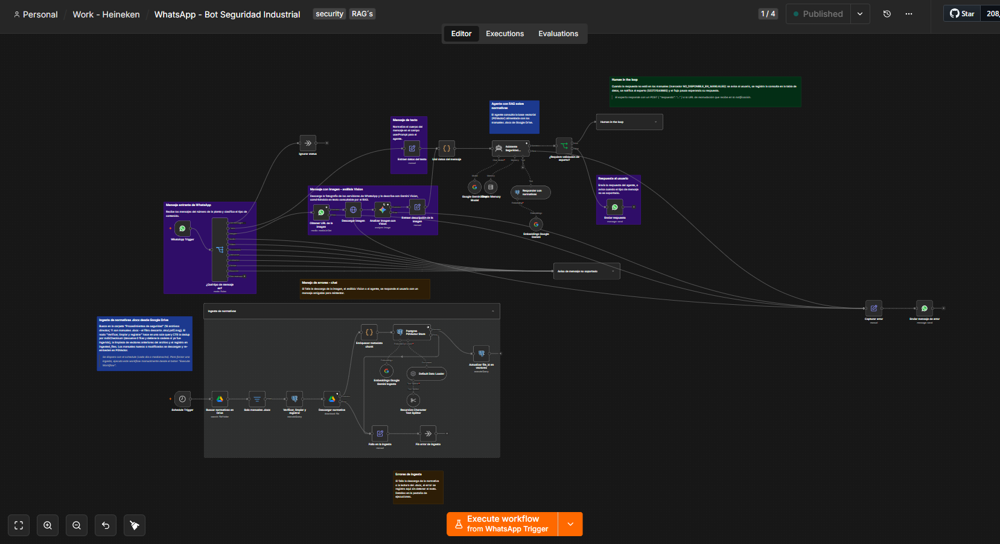
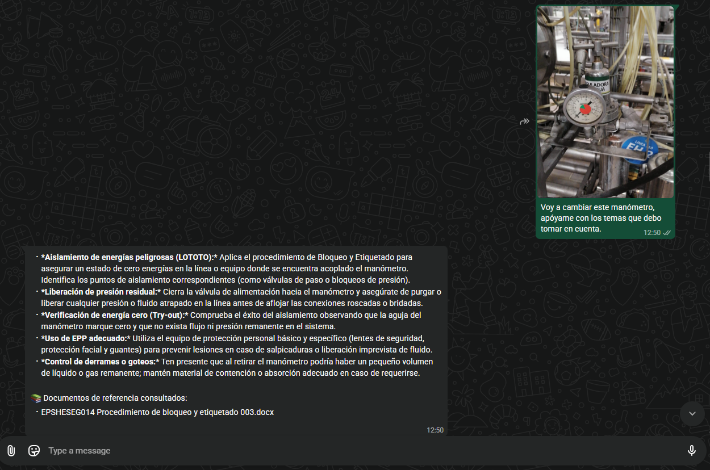

# Industrial Safety WhatsApp RAG Bot 👷‍♂️🚨

## Overview

An end-to-end automated safety assistant designed for manufacturing plant floors. It extracts critical safety protocols (LOTO, confined spaces, hazardous materials) from official `.docx` manuals and delivers verified, step-by-step guidance directly to operators via WhatsApp, using both text and vision analysis.

⚠️ **The Business Problem**

In an industrial environment, safety is the ultimate priority. However, detailed protocols are often buried in 50-page manuals stored on Google Drive. When an operator is on the floor—about to intervene in a 440V electrical panel or replace a high-pressure valve—they don't have the time or a laptop to hunt down the precise steps. We needed a way to democratize instant access to critical safety information without compromising accuracy.

🏗️ **Solution Architecture**

I designed a scalable Retrieval-Augmented Generation (RAG) architecture using n8n to bypass the need for operators to manually search documents:

1. **Ingestion & Data Normalization:** An n8n workflow autonomously downloads new or modified `.docx` safety manuals from Google Drive.
2. **Chunking & Embeddings:** The text is split using a Recursive Character Text Splitter. To prevent the LLM from hallucinating references, the original document name is injected directly into each chunk's text (e.g., `[Documento: EPSHESEG014...]`). Vectors are generated using Google's `gemini-embedding-2` model to ensure proper density.
3. **Vector Database:** The chunks and embeddings are stored in a PostgreSQL pgvector database hosted on NEON.
4. **WhatsApp Agent:** A LangChain Agent in n8n receives text and image queries (analyzed via Gemini Vision) from operators on WhatsApp. It searches the vector database and formats the response strictly following the manual's steps, appending the exact document citations.
5. **Human-in-the-Loop (HITL):** If a query falls outside the scope of the manuals, the Agent triggers a fail-safe. It pauses the workflow and sends a secure, interactive web form link (`$execution.resumeFormUrl`) to an on-duty safety supervisor via WhatsApp. Once the expert inputs the validated instructions, the workflow resumes and delivers the final answer to the operator.

*Full n8n architecture showing the Ingestion Pipeline (bottom) and the Agentic WhatsApp flow with HITL (top).*

*The bot delivering structured safety steps with precise document citations.*

🧠 **Technical Highlights & Decisions**

*   **API Rate Limit Handling:** Initially, embedding a large number of chunks simultaneously caused Google API rate limits, resulting in `0 dimension` vector errors in PostgreSQL. I resolved this by grouping the embeddings into a `Batch Size` of 50 within the n8n PGVector node.
*   **Zero-Hallucination Citations:** LLMs inherently try to summarize or paraphrase document titles in RAG pipelines. I engineered a strict XML-style prompt structure (`<REGLA_CRITICA_DE_CITACION>`) and removed intermediate LLM summarization nodes to force the Agent to extract and cite the exact file names from the vector metadata.
*   **Secure Form-Based Escalation:** Instead of relying on raw HTTP Webhooks for expert validation, I utilized n8n's native Wait node in `On Form Submitted` mode. This provides safety supervisors with a clean UI to read the operator's query and type their response directly from their mobile devices, maintaining workflow cryptographic security.

✅ **Business Impact**

*   **Rapid Access to Protocols:** Reduced the time to retrieve specific LOTO or hazard protocols from minutes to seconds directly on the plant floor.
*   **Risk Mitigation:** Eliminated procedural guesswork by enforcing strict adherence to official, version-controlled documentation.
*   **Expert Time Optimization:** Supervisors only intervene for novel or undocumented scenarios, significantly reducing administrative safety queries.

🚀 **How to Use This Repository**

*   **n8n Workflow:** The export file is located in `workflows/industrial_safety_rag_bot.json`. You can import this directly into your n8n instance to replicate the pipeline.
